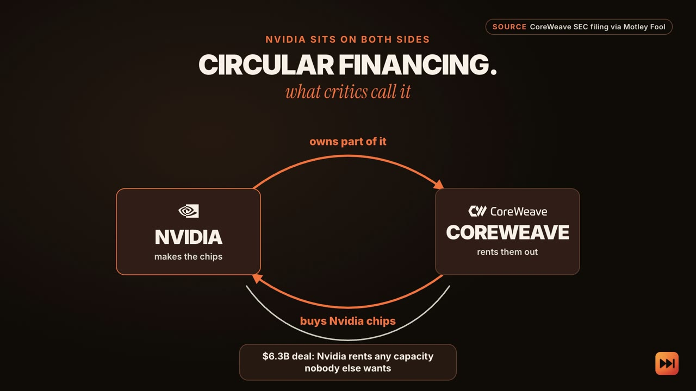
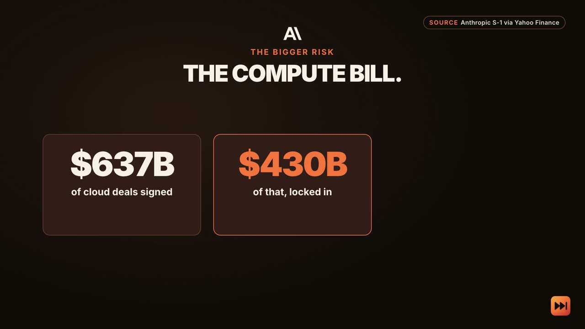

Three things happened in October 2026 that made people ask whether the AI bubble has burst. China's AI stocks lost about 480 billion dollars, lenders started charging CoreWeave much more to borrow, and Anthropic filed to go public with an 80.7 billion dollar loss. In this post I go through each one in plain English, then answer the question I care about most: does any of it change what you pay for AI?

<iframe width="100%" height="400" src="https://www.youtube.com/embed/im_bk21Gytk" title="China Lost $480B | The US Is Cracking | Has the AI bubble burst yet ?!" frameborder="0" allow="accelerometer; clipboard-write; encrypted-media; gyroscope; picture-in-picture" allowfullscreen></iframe>

All figures here are as of October 29, 2026, when I published the video. Nothing in this post is financial advice.

## China: a stock bubble that popped

Shanghai has a stock market just for tech companies, called the STAR Market. Think of it as China's Nasdaq. The STAR 50 tracks the 50 biggest companies on it, and most of them make AI or chips.

In under four months, the STAR 50 fell 40 percent. That's the 480 billion dollars, according to [Reuters, as reported by 24/7 Wall St.](https://247wallst.com/investing/2026/10/28/investors-who-piled-into-chinas-ai-boom-just-watched-about-480-billion-vanish-in-under-four-months-are-americas-ai-bulls-next/) On October 27, Reuters ran the headline "[In China, the AI bubble has already burst](https://www.youtube.com/watch?v=uU2WeAX2w8g)".

The individual companies fell hard too:

- Unitree, the company behind the dancing robot dogs, lost about half its value since its August listing.
- MetaX and Moore Threads, China's answers to Nvidia, roughly halved.

The prices were very high before the fall. At the peak, investors were paying 250 dollars for every dollar of yearly profit. On the Nasdaq 100, it's about 30. Goldman Sachs estimates that AI stocks had grown to 42 percent of China's whole stock market.

So in China, this was a stock bubble, and it popped.

## America: the problem is debt

In America, the problem is debt, not stock prices. The company at the center of it is CoreWeave.

CoreWeave started out mining crypto. Now it buys Nvidia chips with borrowed money and rents them to AI companies that can't get enough computing power. Companies like this are called neoclouds, and CoreWeave is the biggest one.

CoreWeave owed 35.6 billion dollars at the end of June, according to [Fortune](https://fortune.com/2026/10/26/elon-musk-ai-boom-debt-neoclouds/). In October 2026, some of its bonds traded at yields around 15 percent ([CNBC](https://www.cnbc.com/video/2026/10/14/coreweave-falls-amid-ai-debt-fears.html), [BNN Bloomberg](https://www.bnnbloomberg.ca/investing/2026/10/15/coreweave-shares-bonds-slide-further-as-ai-debt-fears-mount/)). A bond yield is roughly the interest lenders demand, and 15 percent means they're worried about getting paid back. A company that owns data centers usually borrows for far less. Its stock fell about 25 percent in one week, according to [Forbes](https://www.forbes.com/sites/the-prompt/2026/10/20/coreweave-stock-plunges-25-as-ai-debt-fears-mount/).

### Nvidia sits on both sides

Nvidia owns part of CoreWeave. It also signed a 6.3 billion dollar deal to rent any CoreWeave capacity nobody else wants ([Motley Fool](https://www.fool.com/investing/2025/10/05/coreweave-nvidia-6-3-billion-backstop-explained/)). So Nvidia invests in CoreWeave, CoreWeave buys Nvidia chips, and Nvidia promises to rent back what CoreWeave can't sell. Critics call this circular financing.

### Elon Musk's "guppy-level death"

On Sunday, October 25, Elon Musk said debt markets have almost entirely shut off money for companies that depend on AI data centers ([Fortune](https://fortune.com/2026/10/26/elon-musk-ai-boom-debt-neoclouds/), [CNBC](https://www.cnbc.com/2026/10/26/neocloud-stocks-today-coreweave-nebius-iren-elon-musk.html)). He said more than 200 companies like CoreWeave face "guppy-level death".

That isn't a term economists use. Guppies have dozens of babies at once, and most of them don't survive. His point is that there are more than 200 of these companies, and he expects only a few to make it. He also said SpaceX is safe, because Starlink makes money outside AI.

Not everyone agrees. Nvidia's Jensen Huang says the opposite, that neocloud demand is off the charts ([Motley Fool](https://www.fool.com/investing/2026/10/28/elon-musk-says-neoclouds-face-a-guppy-level-death/)).

## Anthropic's IPO filing

On Monday, October 26, Anthropic, the company behind Claude, filed to go public. The [S-1 filing](https://www.sec.gov/Archives/edgar/data/0002130357/000162828026067168/anthropicpbc-sx1.htm) shows a net loss of 80.7 billion dollars in six months.

That number looks bad, but most of it is accounting charges, not cash, according to [Yahoo Finance's read of the filing](https://finance.yahoo.com/technology/article/anthropic-publicly-files-ipo-prospectus-noting-strong-revenue-growth-and-massive-spending-131807138.html). Revenue in the same six months was 16.3 billion dollars. In all of 2025, it was 4.6 billion.

The bigger risk is the compute bill. Anthropic has signed up to 637 billion dollars of cloud deals, and about 430 billion of that is locked in. The full 637 billion would pay for a 20 dollar Claude plan for about 32 billion months. All of it is a bet that demand for AI keeps growing for years.

## Does any of this reach your AI bill?

The crash in China hits investors, not users. Chinese labs are still shipping cheap models. Kimi K3.1 Pro came out in October 2026 at half the API price of Opus: 2 dollars per million tokens in and 10 out, against 4 and 20 for Opus ([OpenRouter](https://openrouter.ai/moonshotai/kimi-k3.1-pro)).

In America, Anthropic says Opus 5.5 cut the cost per task by about 40 percent compared to Opus 5 ([Tomasz Tunguz on the S-1](https://tomtunguz.com/anthropics-s1-grew-eleven-fold/)). Labs are competing for your money, and right now that pushes prices down.

The risk is later. If lenders keep pulling back, fewer data centers get built. My guess, and it is only a guess, is that you'd feel that as tighter usage limits before you'd see a higher price.

## What it costs you right now

So what does the bubble cost you? As of October 29, 2026, nothing.

- China's crash hit investors.
- America's debt problem hits the companies renting out chips.
- The AI labs are still cutting prices to win users over.

If that changes, it will start with lenders, so CoreWeave's bond yields will tell you before your bill does. Until then, I'd pay for AI subscriptions monthly, not yearly.

## Credits

The video uses short, muted clips with credit. Watch the full versions:

- Reuters, "[In China, the AI bubble has already burst](https://www.youtube.com/watch?v=uU2WeAX2w8g)"
- CNBC, "[Why CoreWeave is at the center of the AI selloff](https://www.youtube.com/watch?v=Ic1AagONq7Q)"
- The Wall Street Journal, "[How Profitable Is Anthropic? WSJ Reporter Breaks Down Its IPO Filing](https://www.youtube.com/watch?v=q1tw29SieHo)"

Photo of Elon Musk in the video: Debbie Rowe / The Royal Society, [CC BY-SA 3.0, via Wikimedia Commons](https://commons.wikimedia.org/wiki/File:Elon_Musk_Royal_Society_(crop2).jpg). Cover image: Jensen Huang frame from CNBC's interview, Elon Musk photo via [CNBC](https://www.cnbc.com/2026/10/26/neocloud-stocks-today-coreweave-nebius-iren-elon-musk.html) (Getty Images), and "[Texture Fire](https://commons.wikimedia.org/wiki/File:Texture_Fire.jpg)" by Virginie Moerenhout, CC BY 2.0.

## Watch the full video

You can watch [the full video on YouTube](https://www.youtube.com/watch?v=im_bk21Gytk), and find more videos like it on the [SkipTheSub channel](https://www.youtube.com/channel/UC-gO5v-tqnik00EbDL636kg). Which AI company do you think runs out of money first? Tell me in the comments there.
