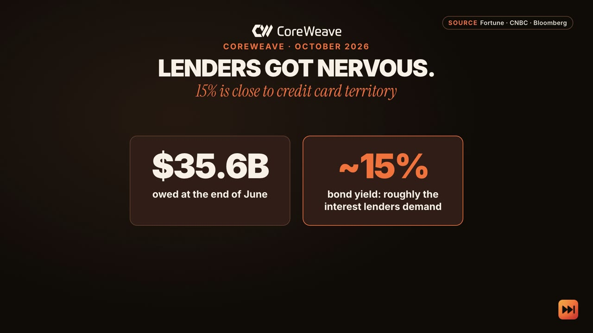

In October 2026, three pieces of news made a lot of people ask whether the AI bubble had finally burst:

- **China's AI stocks lost about $480 billion** in under four months.
- **Lenders started charging CoreWeave around 15 percent** to borrow, a sign they're worried about getting paid back.
- **Anthropic filed to go public** and showed **an $80.7 billion loss** in six months.

If you pay for an AI subscription, the short answer is that **none of this has raised your bill yet**. Below, I go through each story in plain English, then explain where the real risk to your bill is.

_All figures are as of October 29, 2026, when I published the video. Nothing here is financial advice._

## China's AI Stocks Lost $480 Billion in Four Months

Shanghai has a stock market just for tech companies, called the STAR Market. Think of it as China's Nasdaq. The **STAR 50** tracks the 50 biggest companies on it, and most of them make AI or chips.

In under four months, the STAR 50 **fell 40 percent**, wiping out about **$480 billion**, according to [Reuters, as reported by 24/7 Wall St.](https://247wallst.com/investing/2026/10/28/investors-who-piled-into-chinas-ai-boom-just-watched-about-480-billion-vanish-in-under-four-months-are-americas-ai-bulls-next/) On October 27, Reuters ran the headline "[In China, the AI bubble has already burst](https://www.youtube.com/watch?v=uU2WeAX2w8g)".

Some individual companies fell even harder:

- **Unitree**, the company behind the dancing robot dogs, lost about half its value since its August listing.
- **MetaX** and **Moore Threads**, China's answers to Nvidia, roughly halved.

The fall was steep because prices had run far ahead of profits. At the peak, investors in these companies were paying **$250 for every $1 of yearly profit**. On America's Nasdaq 100, that figure is about $30. Goldman Sachs also estimates that AI stocks had grown to **42 percent of China's whole stock market**.

So in China, this was a stock bubble, and it popped. The people who lost money were investors.

## CoreWeave's Lenders Now Want About 15 Percent

In America, the worry isn't stock prices. It's debt, and the company at the center of it is **CoreWeave**.

CoreWeave started out mining crypto. Now it borrows money to buy Nvidia chips, then rents them out to AI companies that need more computing power. Companies like this are called **neoclouds**, and CoreWeave is the biggest one.

At the end of June, CoreWeave owed **$35.6 billion** ([Fortune](https://fortune.com/2026/10/26/elon-musk-ai-boom-debt-neoclouds/)). In October 2026, some of its bonds traded at yields of **around 15 percent** ([CNBC](https://www.cnbc.com/video/2026/10/14/coreweave-falls-amid-ai-debt-fears.html), [BNN Bloomberg](https://www.bnnbloomberg.ca/investing/2026/10/15/coreweave-shares-bonds-slide-further-as-ai-debt-fears-mount/)). A bond yield is roughly the interest lenders demand. A company that owns data centers usually borrows for far less, so 15 percent means lenders are worried about getting paid back. CoreWeave's stock also fell **about 25 percent in one week** ([Forbes](https://www.forbes.com/sites/the-prompt/2026/10/20/coreweave-stock-plunges-25-as-ai-debt-fears-mount/)).

### Nvidia Is on Both Sides of the Deal

Nvidia owns part of CoreWeave. CoreWeave buys Nvidia's chips. And Nvidia signed a **$6.3 billion deal** to rent any CoreWeave capacity nobody else wants ([Motley Fool](https://www.fool.com/investing/2025/10/05/coreweave-nvidia-6-3-billion-backstop-explained/)).

So the money moves in a loop: Nvidia invests in CoreWeave, CoreWeave spends it on Nvidia chips, and Nvidia promises to rent back whatever CoreWeave can't sell. Critics call this **circular financing**.

### Musk Says Most Neoclouds Won't Survive

On Sunday, October 25, Elon Musk said debt markets have almost entirely shut off money for companies that depend on AI data centers ([Fortune](https://fortune.com/2026/10/26/elon-musk-ai-boom-debt-neoclouds/), [CNBC](https://www.cnbc.com/2026/10/26/neocloud-stocks-today-coreweave-nebius-iren-elon-musk.html)). He said the more than 200 neoclouds face **"guppy-level death"**.

Guppies have dozens of babies at once, and most of them don't survive. Musk's point is that there are too many of these companies, and only a few will make it. He also said SpaceX is safe, because Starlink makes money outside AI.

Not everyone agrees. Nvidia's CEO, Jensen Huang, says demand for neoclouds is off the charts ([Motley Fool](https://www.fool.com/investing/2026/10/28/elon-musk-says-neoclouds-face-a-guppy-level-death/)).

## Anthropic's IPO Filing Shows an $80.7 Billion Loss

On Monday, October 26, Anthropic, the company behind Claude, filed to go public. Its [S-1 filing](https://www.sec.gov/Archives/edgar/data/0002130357/000162828026067168/anthropicpbc-sx1.htm), the document a company files with US regulators before selling shares to the public, shows a **net loss of $80.7 billion in six months**.

That looks alarming, but most of it is accounting charges, not cash actually spent, according to [Yahoo Finance's read of the filing](https://finance.yahoo.com/technology/article/anthropic-publicly-files-ipo-prospectus-noting-strong-revenue-growth-and-massive-spending-131807138.html). Revenue in those six months was **$16.3 billion**, compared with **$4.6 billion for all of 2025**.

The bigger risk is the compute bill. Anthropic has signed up to **$637 billion of cloud deals**, and about **$430 billion** of that is locked in. For scale, the full $637 billion would pay for a $20 Claude plan for about 32 billion months. All of it is a bet that demand for AI keeps growing for years.

## Will Any of This Raise Your AI Bill?

Not yet.

The crash in China hit investors, not users, and Chinese labs are still shipping cheap models. **Kimi K3.1 Pro**, released in October 2026, costs **half as much as Claude Opus 5.5** through the API: $2 per million input tokens and $10 per million output tokens, against $4 and $20 for Opus ([OpenRouter](https://openrouter.ai/moonshotai/kimi-k3.1-pro)).

In America, Anthropic says **Opus 5.5 cut the cost per task by about 40 percent** compared with Opus 5 ([Tomasz Tunguz on the S-1](https://tomtunguz.com/anthropics-s1-grew-eleven-fold/)). Labs are competing for your money, and for now that pushes prices down.

The risk comes later. If lenders keep pulling back, fewer data centers get built. My guess, and it is only a guess, is that you'd feel that first as **tighter usage limits**, before you'd see a higher price.

## What It Costs You Today

So what does the AI bubble cost you right now? As of October 29, 2026, **nothing**.

- China's crash hit **investors**.
- America's debt problem hits the **companies renting out chips**.
- The AI labs are still **cutting prices** to win users.

If that changes, it will start with lenders, so watch CoreWeave's bond yields: they'll move before your bill does. Until then, **pay for AI subscriptions monthly, not yearly**.

## Watch the Full Video

The full video covers all of this in about five minutes.

<iframe style="width: 100%; aspect-ratio: 16 / 9; height: auto;" src="https://www.youtube.com/embed/im_bk21Gytk" title="China Lost $480B | The US Is Cracking | Has the AI bubble burst yet ?!" frameborder="0" allow="accelerometer; clipboard-write; encrypted-media; gyroscope; picture-in-picture" allowfullscreen></iframe>

For more videos like it, see the [SkipTheSub channel](https://www.youtube.com/channel/UC-gO5v-tqnik00EbDL636kg). Which AI company do you think runs out of money first? Tell me in the comments there.

## Credits

The video uses short, muted clips with credit. Watch the full versions:

- Reuters, "[In China, the AI bubble has already burst](https://www.youtube.com/watch?v=uU2WeAX2w8g)"
- CNBC, "[Why CoreWeave is at the center of the AI selloff](https://www.youtube.com/watch?v=Ic1AagONq7Q)"
- The Wall Street Journal, "[How Profitable Is Anthropic? WSJ Reporter Breaks Down Its IPO Filing](https://www.youtube.com/watch?v=q1tw29SieHo)"

Photo of Elon Musk in the video: Debbie Rowe / The Royal Society, [CC BY-SA 3.0, via Wikimedia Commons](https://commons.wikimedia.org/wiki/File:Elon_Musk_Royal_Society_(crop2).jpg). Cover image: Jensen Huang frame from CNBC's interview, Elon Musk photo via [CNBC](https://www.cnbc.com/2026/10/26/neocloud-stocks-today-coreweave-nebius-iren-elon-musk.html) (Getty Images), and "[Texture Fire](https://commons.wikimedia.org/wiki/File:Texture_Fire.jpg)" by Virginie Moerenhout, CC BY 2.0.
