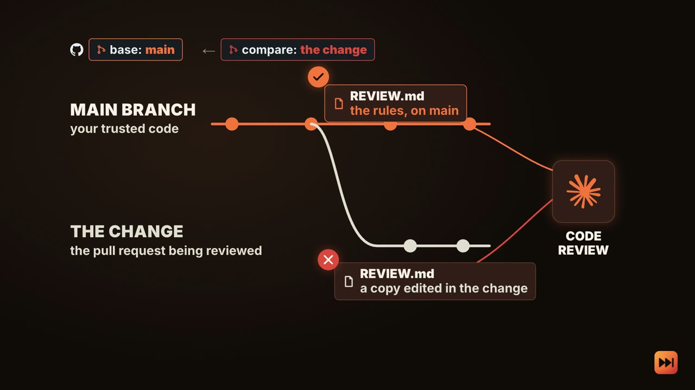
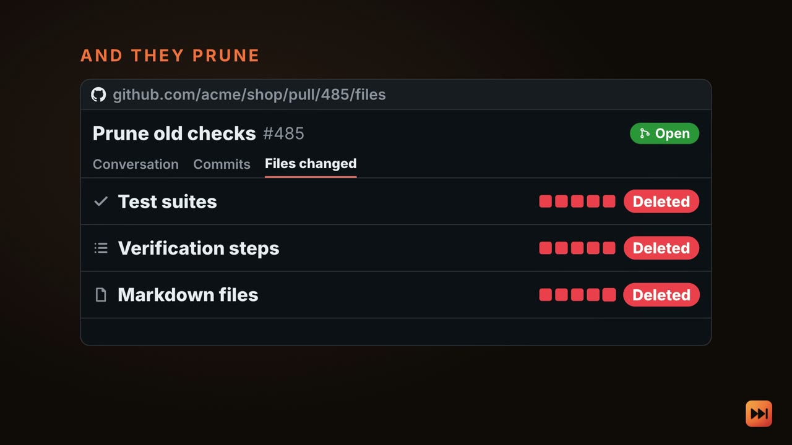

On November 16, 2026, Addy Osmani, from the Claude team, published a post on how the Claude Code team checks the code Claude writes. Here is what it says:

- **About 90 percent** of the Claude Code team's code is written and reviewed by Claude.
- **One rule** sits under everything: whatever checks Claude's work must be something Claude can't change.
- **Five ideas** follow from it, from the kinds of tests to a commit gate that stops unverified work.

The short answer to how they know the code works: **they judge it with checks Claude can't edit, and they run the changed app itself instead of trusting a test report.** This post goes through the rule, their five review and verification practices, and where to start in your own repo.

_Everything here comes from [Addy's post on claude.dev](https://claude.dev/blog/how-the-claude-code-team-thinks-about-verification/) and the [Claude Code docs](https://code.claude.com/docs/en/code-review-customize), as of November 19, 2026. I did not run these setups myself._

## Claude Wrote the Tests, So "All Tests Pass" Proves Little

Claude can report that every test passed. But Claude also wrote those tests, and it can edit them, so a pass doesn't prove much.

The usual fix is to open the diff, the list of changed lines, and read all of it. That takes longer than it took Claude to write the change. Merging code nobody read feels risky too.

## The Judge Has to Be Something Claude Can't Edit

Addy's rule is that whatever checks Claude's work has to be something Claude can't change. If Claude can edit the checker, a pass proves nothing. In his words, if a change can modify the check that judges it, the check is broken.

## Without Checks You Run One or Two Claudes, With Them Dozens

Addy says that without checks you can only run **one or two Claudes at a time**, because you have to review everything yourself. That makes you the bottleneck.

With checks Claude can run itself, he says you can run **dozens of Claudes, or even hundreds**, in parallel. Your job stops being reading every diff. It becomes defining what "done" means and reviewing the evidence.

This works now because checks got cheap. Agents can write tests, benchmarks and specs, and those run as ordinary software, so they don't use many extra tokens. Writing them used to be the expensive part.

## Three Kinds of Tests Worth Having: End-to-End, Property and Differential

Addy warns about two kinds of tests. Flaky tests, which pass and fail at random, teach Claude to rerun them until they pass instead of fixing the code. Slow tests mean fewer runs, and the problem gets harder to pinpoint. He picks three kinds that work well:

- **End-to-end tests** follow a real user flow, such as adding to the cart, checking out and reaching the confirmation page. You either reach the page or you don't, which is why Addy calls them hard to fool.
- **Property tests** state something that must always hold, such as an account balance never going negative. A library then throws thousands of inputs at it until it holds or breaks. Addy names fast-check, Hypothesis and proptest, and says they suit rewrites, where the spec has drifted away from what production actually does.
- **Differential tests** run the old system and the new one on the same inputs and flag every difference. You normalize the boring differences, such as whitespace, and keep a list of approved differences for places where the new system should differ.

## The Verify Skill: Claude Runs the App Instead of Trusting Tests

For this team, verification means running the change. Claude tests the app the way a QA engineer would: the Chrome extension for web, a mobile MCP (a tool Claude can use) for iOS or Android, computer use for desktop, or running the service locally for a backend. Addy's line is that running the app end to end matters more than tests.

The team writes this down in a skill called **verify**. A skill is a markdown file in your repo that Claude reads before it does a job. This one tells Claude to start the app, use the feature that changed, and report what it saw. It sits in the skills folder, close to the code. Addy says the team tests nearly all changes this way, and that you make the skill fast and reliable by having Claude iterate on it and stress-test it.

## Claude Code Review Reads REVIEW.md From Main, Not the Change

If a check is still failing after three rounds, Claude stops and brings in a human.

The team also uses **REVIEW.md**, a file at the root of your repo that tells the code reviewer what to flag, how serious it is, and what to skip. The team keeps one main reviewer instead of many, tunes this file over time, and later review rounds build on what earlier ones found.

This ties back to the rule. Code review reads REVIEW.md from the base branch, which is your main branch, never from the change being reviewed. The Claude Code docs say the same. Otherwise a change could rewrite the rules it is judged by.

## The Commit Gate Blocks Work That Was Never Verified

A commit is when Claude saves its changes into your repo. The commit gate is a checkpoint that runs at that moment, and it does two things:

1. It stamps every commit with how it was verified, or with "none", so you can search for unverified ones.
2. It can block a commit if that session, meaning the conversation Claude just had, never ran a review or a verify step.

The gate runs every time Claude tries to commit, before the change lands in your repo's history. If the session shows a review or verify step, the commit goes through. If not, what happens depends on the mode. Addy doesn't spell out how the gate is wired up, so treat it as an idea to copy, not a recipe.

There are **three modes**:

- **Off** does nothing.
- **Observe** lets every commit through but records what it would have blocked, so you can find false alarms.
- **Enforce** blocks the commit, and Claude can explain in the commit message why it skipped verification.

If Claude is blocked twice in one session, the next commit goes through, so it doesn't get stuck.

## The Checks Get Checked and Pruned Too

The last idea is that the checks need checking. The team tracks changes that were merged and later reverted, changes a maintainer rejected before merging, and a size-matched set of changes that stayed clean.

When something slips through, they turn it into a rule. A pattern has to show up in at least two reviews and be spottable from a diff. Then three agents try to disprove it, and a human signs off.

Flaky tests get a hard rule: Claude can't skip them, add sleeps, or retry until they pass. If it can't find the root cause, it deletes the test and writes down why.

The team also prunes. Test suites, verification steps and markdown files only grow if you let them.

## Start With a Verify Skill in Your Repo

The whole setup comes down to three things: a way for Claude to run the work, a judge it can't edit, and a rule for when to stop. If you add one thing, **add a verify skill to your repo**.

I wrote a [starter verify skill file](https://gist.github.com/isVivek99/21aaa3fd4e34007f0a77eb58839155b9) based on how Addy describes it. It is not an official Anthropic or Claude Code template. Save it as `.claude/skills/verify/SKILL.md` and fill in the "Your app" section.

## Watch the Full Video

The video walks through the same five ideas with diagrams.

<iframe style="width: 100%; aspect-ratio: 16 / 9; height: auto;" src="https://www.youtube.com/embed/QV3x7fvgSrY" title="5 Checks the Claude Code Team Runs on 90% AI Written Code" frameborder="0" allow="accelerometer; clipboard-write; encrypted-media; gyroscope; picture-in-picture" allowfullscreen></iframe>

More videos on the [SkipTheSub channel](https://www.youtube.com/channel/UC-gO5v-tqnik00EbDL636kg).

## Credits

- Photo of Addy Osmani in the video and thumbnail: addyosmani.com press page.
- Clip in the video's subscribe moment: Netflix, Nouvelle École.
