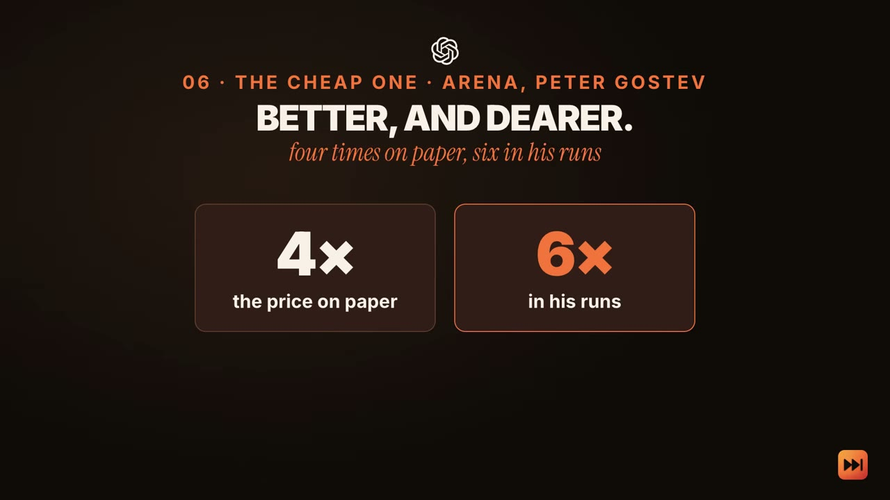

OpenAI released two new models, **GPT-6.2 Astra** and **GPT-6.2 Sol**, and the first reviews disagree sharply. Here are the main findings:

- **Astra costs $8 per million input tokens and $40 per million output tokens**, the same price as Claude Fable 5.2.
- **OpenAI says Astra scores 5.5 points higher than Claude Fable 5.2 at about 5 percent of the cost** on one of its own tests.
- **Theo, a YouTuber who got early access, calls Astra the worst model OpenAI has released**, while others call it a solid minor update.
- **Sol costs a quarter of Astra's price**, and one reviewer prefers it for daily work.

If you pay for Claude, the short answer is **stay on Claude Fable 5.2 for long agent runs, try Sol for UI, games and first drafts, and keep Astra for one-off hard jobs**. Below I go through the price, the scores, the complaints and the Sol comparison.

_All figures are as of November 20, 2026, when I published the video. Most are the vendors' own numbers or other people's tests, not mine._

## Two Models: Astra for Hard Projects, Sol for Everyday Work

Astra is the frontier model, built for the hardest projects. Sol is the efficient one for everyday work. Both are in ChatGPT, Codex and the API, with a context window of 1 million tokens (the amount of text a model can read at once). The details are in [OpenAI's launch post](https://openai.com/index/introducing-gpt-6-2-astra-sol/).

Astra is a second attempt. OpenAI cancelled an earlier Astra release in late September, a day before its developer conference. The Wall Street Journal reported it fell short on staying within scope and authorization, and on how it communicates back to the user.

AI labs give a few creators early access, so their opinions are recorded before launch day. An OpenAI employee replied that OpenAI made many changes in the last three or four days before launch, after the creators got access. Theo says he re-ran his tests after those changes and still dislikes the model.

## Astra Costs the Same $8 and $40 as Claude Fable 5.2

API prices are quoted per million tokens, split into input tokens (what you send) and output tokens (what the model writes back).

- **GPT-6.2 Astra:** $8 input, $40 output.
- **Claude Fable 5.2:** $8 input, $40 output. Both models started at $10 and $50 and are now at $8 and $40.
- **GPT-6.2 Sol:** $2 input, $10 output, the same as its predecessor.
- **Claude Opus 5.5:** $4 input, $20 output. Sol costs half of that, and a quarter of Astra.

They differ on cached input, the text a coding agent re-reads all day. Claude Fable 5.2 charges $0.20 per million tokens for it. Astra charges $0.40.

Both companies also discount work that can wait. OpenAI's new background mode, in public beta, takes up to 40 percent off per token if your first response can wait two or eight hours. Anthropic's pricing page says batch processing saves 50 percent.

## Astra Scores 62 on an Independent Index, Three Points Behind Claude

An independent intelligence index runs the same tests on every model. It scores Claude Fable 5.2 at 65, Astra at 62, Gemini 4 Carbon at 60, Claude Opus 5.5 at 59 and Sol at 57. Claude still has the top spot by three points.

OpenAI's pitch is cost. On its own test, Agents Last Exam, OpenAI says Astra scores 5.5 points above Claude Fable 5.2 at about 5 percent of the cost. That is OpenAI's figure from OpenAI's run. [Theo](https://www.youtube.com/watch?v=9KvI-zg4mfo) read out the numbers: Claude Fable 5.2 at about $60 for 72.8 percent, and Astra at $2.89 for 78.3 percent.

It is not only OpenAI's numbers. On the [Mercor OpenWorldEngineer leaderboard](https://www.mercor.com/apex/open-world-engineer-leaderboard/), a long engineering test, Astra scores 67.2 percent and Claude Fable 5.2 scores 54.6 percent. Theo's own benchmarks put Astra at about half of Claude Fable 5.2's cost and Sol at close to an eighth.

So Astra is slightly behind on the independent score and far cheaper per task.

## Theo Lists Four Complaints Despite Astra's Cheap, Strong Scores

Theo's numbers say Astra is cheap and strong, and he still wrote an article with 1.8 million views titled "Why I Hate GPT 6.2 Astra". He lists four complaints:

1. **It does not know what you know.** Told to remaster Final Fantasy VII, it asked him about something he says he had never heard of. On another job, two hours in, it stopped to ask about file path permissions he had never seen.
2. **Its summaries are hard to read.** He asked why builds were slow on one machine. Astra wrote four paragraphs about PNPM internals, a package manager. Claude Opus said the SSD was slow.
3. **It loops.** On his TypeScript compiler project, Theo says Astra ran for 7 days, landed zero improvements and made the compiler 56 percent slower. Claude Opus then made it 50 percent faster in 2 days.
4. **It repeats itself.** Theo asked for a new game level and got a planet named Bellwether. His co-host asked for a different game and got Bellwether. Ethan Mollick asked for a spy game in any setting and got Bellwether Station.

Matt Shumer called Astra essentially unusable. He says his Claude agents rejected most of Astra's sub-agent work because it did not follow instructions.

Others disagree. Pietro Schirano, who also had early access, says Astra is getting an unfair response and that most issues came from the harness (the tool wrapping the model). He says that once he removed it, "I was flying." Swyx from Latent Space calls Astra a solid minor version improvement, and his main complaint is the launch ad. Even Theo says it is a great reviewer, that its computer use is excellent and that it is world-class at 3D.

## Sol Costs a Quarter of Astra, but Wins on UI and Motion

Peter Gostev at [Arena](https://www.youtube.com/watch?v=2viKnCdnnPY) ran Astra and Sol side by side on 3D scenes, games, slides and websites. His verdict is that Astra is the better model, but it costs about 4 times as much on paper and closer to 6 times in his runs. One scene cost $10 on Astra and $1.50 on Sol.

Sol won on motion, camera work and UI range. Gostev says Astra's output is too similar from one run to the next and that it loves the color green. His own pick is **Sol for daily work and Astra for the hard cases**.

OpenAI says many of its employees use Sol as their default model. It also says that on Cognition's Frontier Code 2.0, Sol lands within half a point of Astra at about a fifth of the cost. Both are OpenAI's own figures.

## Who Should Switch: Stay, Try Sol, or Pay for Astra

- **If you pay for Claude Fable 5.2 and run long agents, stay.** The loops and hard-to-read summaries are exactly what costs you time. That is my read from Theo's account, not something I measured.
- **If your work is UI, games or bulk first drafts, try Sol.** It costs a quarter of Astra, and Gostev likes it for daily work.
- **If you need a one-off big engineering run or a detailed 3D scene, Astra looks worth the money.** The Mercor leaderboard and Arena's scenes both point that way.

Whichever you pick, test it on your own work for a day before you cancel anything. All of these reviews are from the first week after launch, and OpenAI changed things right before it.

## Watch the Full Video

The video walks through the prices, scores and reviews in order.

<iframe style="width: 100%; aspect-ratio: 16 / 9; height: auto;" src="https://www.youtube.com/embed/XurH3kgV2wM" title="GPT-6.2 Astra &amp; Sol: Genius or Overhyped?" frameborder="0" allow="accelerometer; clipboard-write; encrypted-media; gyroscope; picture-in-picture" allowfullscreen></iframe>

More tests like this are on the [SkipTheSub YouTube channel](https://www.youtube.com/channel/UC-gO5v-tqnik00EbDL636kg).

## Credits

- [OpenAI launch post](https://openai.com/index/introducing-gpt-6-2-astra-sol/).
- [Mercor OpenWorldEngineer leaderboard](https://www.mercor.com/apex/open-world-engineer-leaderboard/).
- [Theo (t3.gg)](https://www.youtube.com/watch?v=9KvI-zg4mfo) for the benchmarks, complaints and posts shown.
- [Arena, Peter Gostev](https://www.youtube.com/watch?v=2viKnCdnnPY) for the Astra and Sol comparison.
- Posts by Swyx and others quoted above. The numbers shown are the sources' own figures and are not tested by this channel.
